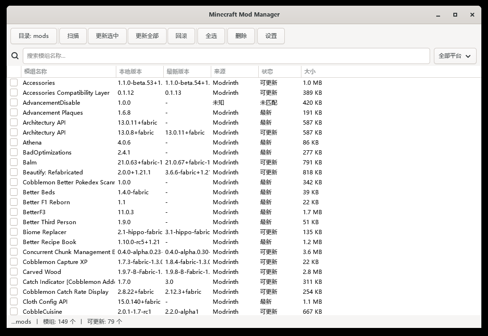

# Minecraft Mod Manager

一个用 **C11 + GTK4** 写的 Windows 原生 Minecraft 模组管理器。扫描模组目录、检测可用更新、一键更新、任意回滚、批量删除，全部在一个约 350 KB 的单文件程序里完成，**不需要 Java 运行时**。

[English](README_EN.md) · [MIT License](LICENSE)



---

## 功能

- **扫描**：直接解析 `.jar` 内的 `fabric.mod.json`、`META-INF/mods.toml`、`mcmod.info`，取出模组名、版本、加载器、对应的 Minecraft 版本。
- **识别**：用文件 **SHA1** 调用 Modrinth 批量接口 `/version_files`，一次请求识别上百个模组，不依赖文件名猜测。
- **版本检测**：按加载器分组调用 `/version_files/update`，带上实例的 Minecraft 版本，只比对真正兼容的版本，避免跨版本误报。
- **一键更新**：更新选中 / 更新全部，多模组并行下载，下载前后自动备份，备份份数可配置。
- **分段下载**：大文件按「分段数」（1–128，可在设置里调）并发下载，规避 CDN 的单连接限速。
- **回滚**：列出某个模组的所有历史备份，选择任意一份即可还原。
- **批量删除**：可选择“先备份再删除”或“彻底删除”。
- **搜索与筛选**：按名称实时过滤，或按来源平台筛选。
- **模组详情**：双击任意一行查看完整元数据。
- **目录切换**：工具栏最左侧的按钮可以直接换模组目录，切换后立即重新扫描。

## 快捷键

| 按键 | 作用 |
|---|---|
| `F5` | 重新扫描 |
| `Ctrl+A` | 全选 |
| `Ctrl+D` | 取消全选 |
| `Delete` | 删除选中 |
| 双击 | 查看模组详情 |

---

## 下载与运行

从 [Releases](../../releases) 下载：

| 包 | 说明 |
|---|---|
| `MinecraftModOption-vX.Y.Z-win64-portable.zip` | **推荐**。解压到任意目录，双击 `MinecraftModOption.exe` 即可，已附带 GTK4 等全部运行时 DLL，无需安装任何东西 |
| `MinecraftModOption.exe` | 单文件，体积小，但需要自行提供 GTK4 运行时（把 MSYS2 的 `ucrt64\bin` 加入 `PATH`，否则会提示找不到 `libcurl-4.dll`、`libgtk-4-1.dll` 等） |

便携版解压后文件夹里除了 exe 还有一批 `lib*.dll`，它们是 GTK4 的运行时依赖，**不要删除**，也不要单独把 exe 拷走。

---

## 构建

需要 **MSYS2 (UCRT64 或 MinGW64)**，并安装 GTK4 与依赖：

```bash
pacman -S mingw-w64-ucrt-x86_64-gcc \
          mingw-w64-ucrt-x86_64-gtk4 \
          mingw-w64-ucrt-x86_64-cjson \
          mingw-w64-ucrt-x86_64-curl \
          mingw-w64-ucrt-x86_64-cmake \
          mingw-w64-ucrt-x86_64-ninja

mkdir build && cd build
cmake .. -G Ninja
ninja
```

产物为 `build/MinecraftModOption.exe`。把 MSYS2 的 `ucrt64\bin` 加入 `PATH` 后即可直接运行（GTK4 的 DLL 必须能被找到）。

### 打包便携版

```bash
# 递归收集 exe 依赖的全部 MSYS2 DLL，与 exe 放在同一目录
# 依赖用 objdump -p <文件> 读取 "DLL Name:" 得到，逐层展开
```

把 `MinecraftModOption.exe` 和收集到的 70 余个 DLL（`libgtk-4-1.dll`、`libcurl-4.dll`、`libcjson-1.dll`、`libglib-2.0-0.dll` …）放在同一目录即为免安装版本，GTK4 会自动从 exe 所在目录加载。图标资源由 `logo.rc` 引用 `assets/icon.ico`，由 windres 在构建时编译进可执行文件。

---

## 使用

1. **设置目录**：点击工具栏最左侧的 `目录: …` 按钮选择模组目录；或在 `设置` 里配置备份目录、最大备份数、更新前是否自动备份。
2. **扫描**：按 `F5` 或点 `扫描`，程序会解析全部 jar、计算 SHA1 并向 Modrinth 查询。
3. **更新**：勾选后点 `更新选中`，或直接点 `更新全部`。
4. **回滚 / 删除**：选中一行后分别使用 `回滚`、`删除`。

状态栏显示当前目录、模组总数与可更新数量。

### 配置文件

`config.json` **保存在程序启动时的工作目录**，不是 exe 所在目录：

```json
{
    "mod_dir": "C:\\Users\\You\\AppData\\Roaming\\.minecraft\\mods",
    "backup_dir": "C:\\Users\\You\\AppData\\Roaming\\.minecraft\\mods\\backups",
    "max_backups": 5,
    "curseforge_api_key": "",
    "auto_scan_on_start": true,
    "backup_before_update": true,
    "download_segments": 4
}
```

| 字段 | 说明 |
|---|---|
| `mod_dir` | 模组目录 |
| `backup_dir` | 备份目录 |
| `max_backups` | 每个模组保留的备份份数，`0` 表示不限制 |
| `curseforge_api_key` | CurseForge API Key（预留字段，当前版本检测以 Modrinth 为主） |
| `auto_scan_on_start` | 启动后自动扫描 |
| `backup_before_update` | 更新前自动备份 |
| `download_segments` | 大文件下载的分段并发数，`1` 表示单连接，最多 `128`（默认 `4`） |

---

## 技术栈

| 层次 | 选型 |
|---|---|
| 语言 | C11 (GNU11) |
| GUI | GTK4（`GtkTreeView` + `GtkListStore`） |
| HTTP | libcurl（WinSSL） |
| JSON | cJSON |
| 压缩 | zlib（直接解析 ZIP 结构解压 jar 内的元数据） |
| 哈希 | Windows CryptoAPI 计算 SHA1 |
| 构建 | CMake + Ninja + windres |

### 代码结构

```
src/
├── main.c            程序入口，初始化 GTK 与主窗口
├── app.c             应用级状态（配置、模组列表）
├── main_window.c     主窗口、工具栏、扫描线程、更新/删除/回滚的调度
├── mod_list.c        模组列表容器
├── mod_list_view.c   列表视图（7 列、状态着色）
├── scanner.c         ZIP 解析 + fabric.mod.json / mods.toml / mcmod.info
├── modrinth.c        Modrinth 批量接口：识别、检测更新、取项目名
├── curseforge.c      CurseForge 接口（预留）
├── updater.c         下载、备份、替换文件
├── rollback.c        备份枚举与回滚
├── deleter.c         删除（可选保留备份）
├── cache.c           远端版本信息缓存
├── config.c          config.json 读写
├── network.c         libcurl 封装（GET / POST JSON）
└── hash.c            SHA1 计算
```

---

## 常见问题

**为什么界面里没有 emoji？**
本机 MSYS2 的 cairo 1.18.6 在渲染 Windows 的 COLRv1 彩色字体（`Segoe UI Emoji`）时会直接 `abort()`，表现为程序启动即退出（退出码 `0xC0000409`）。因此界面文本一律使用纯文字或单色符号。这个问题与渲染后端无关，`GSK_RENDERER` 换成 gl / cairo / vulkan 都一样。

**为什么有的模组显示“未匹配”？**
识别完全依赖文件哈希。自己改过、重新打包过，或只在 GitHub / CurseForge 分发的 jar，在 Modrinth 上找不到对应文件，就会退化成显示 jar 内的元数据。

**更新会不会跨 Minecraft 版本？**
不会。`/version_files/update` 请求里会带上实例的 Minecraft 版本（由已识别模组中出现最多的游戏版本推断）和各自的加载器。

---

## 许可

[MIT](LICENSE)
