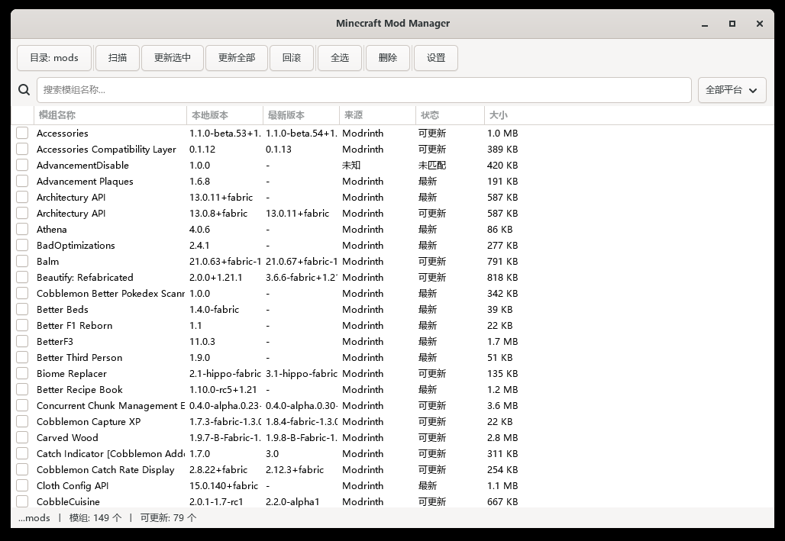

# Minecraft Mod Manager

A native Windows GUI for managing Minecraft mods, written in **C11 + GTK4**. Scan your mods folder, detect available updates, update in one click, roll back to any previous backup, and delete mods in bulk — all in a single roughly 350 KB executable, with **no Java runtime required**.

[中文](README.md) · [MIT License](LICENSE)



---

## Features

- **Scan** — reads `fabric.mod.json`, `META-INF/mods.toml`, or `mcmod.info` straight out of each `.jar` to extract name, version, loader and target Minecraft version.
- **Identify** — matches local files by **SHA1** through Modrinth's bulk `/version_files` endpoint, so identification never relies on guessing from file names.
- **Update detection** — groups mods by loader and calls `/version_files/update` with the instance's Minecraft version, so only genuinely compatible versions are compared.
- **One-click update** — update selected or update all, with automatic backup before replacement and a configurable retention limit.
- **Rollback** — lists every historical backup of a mod and restores any of them.
- **Batch delete** — keep a backup or delete permanently.
- **Search and filter** — filter by name in real time, or by source platform.
- **Mod details** — double-click a row to inspect its full metadata.
- **Directory switcher** — the leftmost toolbar button changes the mods folder and rescans immediately.

## Keyboard shortcuts

| Key | Action |
|---|---|
| `F5` | Rescan |
| `Ctrl+A` | Select all |
| `Ctrl+D` | Deselect all |
| `Delete` | Delete selected |
| Double-click | Show mod details |

---

## Build

Requires **MSYS2 (UCRT64 or MinGW64)** with GTK4 and friends:

```bash
pacman -S mingw-w64-ucrt-x86_64-gcc \
          mingw-w64-ucrt-x86_64-gtk4 \
          mingw-w64-ucrt-x86_64-cjson \
          mingw-w64-ucrt-x86_64-curl \
          mingw-w64-ucrt-x86_64-cmake \
          mingw-w64-ucrt-x86_64-ninja

mkdir build && cd build
cmake .. -G Ninja
ninja
```

The result is `build/MinecraftModOption.exe`. Add MSYS2's `ucrt64\bin` to `PATH` before running it — the GTK4 DLLs must be discoverable.

The window icon is declared in `logo.rc`, which points at `assets/icon.ico` and is compiled into the executable by windres.

---

## Usage

1. **Pick a directory** — click the leftmost `目录: …` toolbar button, or configure the backup directory, backup retention and pre-update backup behaviour in `设置` (Settings).
2. **Scan** — press `F5` or click `扫描` (Scan). Every jar is parsed, hashed, and queried against Modrinth.
3. **Update** — select rows and click `更新选中` (Update selected), or click `更新全部` (Update all).
4. **Rollback / delete** — select a row and use `回滚` (Rollback) or `删除` (Delete).

The status bar shows the active directory, total mod count and how many updates are available.

### Configuration

`config.json` is stored in the **working directory the program was started from**, not next to the executable:

```json
{
    "mod_dir": "C:\\Users\\You\\AppData\\Roaming\\.minecraft\\mods",
    "backup_dir": "C:\\Users\\You\\AppData\\Roaming\\.minecraft\\mods\\backups",
    "max_backups": 5,
    "curseforge_api_key": "",
    "auto_scan_on_start": true,
    "backup_before_update": true
}
```

| Field | Meaning |
|---|---|
| `mod_dir` | Mods directory |
| `backup_dir` | Backup directory |
| `max_backups` | Backups kept per mod, `0` means unlimited |
| `curseforge_api_key` | Reserved for CurseForge; detection currently uses Modrinth |
| `auto_scan_on_start` | Scan automatically at startup |
| `backup_before_update` | Back up before updating |

---

## Tech stack

| Layer | Choice |
|---|---|
| Language | C11 (GNU11) |
| GUI | GTK4 (`GtkTreeView` + `GtkListStore`) |
| HTTP | libcurl (WinSSL) |
| JSON | cJSON |
| Compression | zlib (ZIP structures parsed directly to read jar metadata) |
| Hashing | Windows CryptoAPI (SHA1) |
| Build | CMake + Ninja + windres |

### Layout

```
src/
├── main.c            Entry point, GTK setup, main window
├── app.c             Application state (config, mod list)
├── main_window.c     Main window, toolbar, scan thread, update/delete/rollback dispatch
├── mod_list.c        Mod list container
├── mod_list_view.c   List view (7 columns, status colouring)
├── scanner.c         ZIP parsing + fabric.mod.json / mods.toml / mcmod.info
├── modrinth.c        Modrinth bulk endpoints: identify, check updates, project names
├── curseforge.c      CurseForge client (reserved)
├── updater.c         Download, back up, replace files
├── rollback.c        Backup enumeration and restore
├── deleter.c         Delete with optional backup
├── cache.c           Remote version cache
├── config.c          config.json read/write
├── network.c         libcurl wrapper (GET / POST JSON)
└── hash.c            SHA1
```

---

## FAQ

**Why is there no emoji in the UI?**
cairo 1.18.6 as shipped by MSYS2 calls `abort()` when rendering colour glyphs from Windows' COLRv1 fonts (`Segoe UI Emoji`), which makes the program exit immediately at startup with `0xC0000409`. All UI text therefore uses plain text or monochrome symbols. This is independent of the renderer — `GSK_RENDERER=gl|cairo|vulkan` all behave the same.

**Why do some mods show as unmatched?**
Identification relies entirely on the file hash. Jars that were modified, repacked, or distributed only via GitHub / CurseForge cannot be found on Modrinth and fall back to showing the metadata stored inside the jar.

**Can an update cross Minecraft versions?**
No. The `/version_files/update` request includes the instance's Minecraft version (inferred from the most common game version among identified mods) and each mod's own loader.

---

## License

[MIT](LICENSE)
